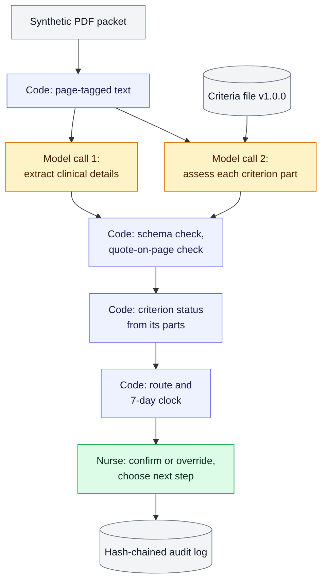

# PA Review Assistant (demo)

[](https://github.com/carolfalabella/pa-review-assistant/actions/workflows/tests.yml)

> **Synthetic data only.** Every patient, member, provider, and clinical detail in this repository is invented. Never use it with real patient data.
>
> **Criteria are illustrative.** The four sample criteria were written for this demo. They are not a coverage policy, not MCG or InterQual content, and have not been reviewed by a licensed clinician.
>
> **AI prepares the case; a licensed clinician decides.** There is no deny or partial-approval action anywhere in the code.

A proof of concept for a payer's utilization management (UM) nurse. It reads an unstructured prior authorization packet, extracts the key clinical details, and checks each sample criterion as **met**, **not met**, or **missing**, with every result cited back to an exact quote on a source page. The nurse confirms or overrides each criterion and chooses the next step. Every step is recorded in a tamper-evident audit log.

**Demo case:** outpatient MRI of the lumbar spine without contrast (CPT 72148) for lumbar radiculopathy (ICD-10-CM M54.16), Medicare Advantage, standard request, 7-day decision clock.

**Model:** `gemini-3.6-flash` through the Gemini API (free tier, synthetic data only). Switching providers is one setting.

## Quick start

Requires Python 3.11 or later. Tested on Windows 11 with Python 3.15 and Streamlit 1.67.

```powershell
python -m venv .venv
.venv\Scripts\Activate.ps1          # macOS/Linux: source .venv/bin/activate
pip install -r requirements.txt
python -m pytest -q                  # no network or API key needed
streamlit run app.py
```

In the app, choose **Saved run** and click **Run review**. This replays a recorded Gemini response for the demo packet, needs no API key, and still runs every code check live.

To call the model live, copy `.env.example` to `.env`, add a Gemini API key from Google AI Studio, and choose **Live: Gemini**.

Command line, without the app:

```powershell
python -m src.pipeline data\synthetic\case_001.pdf            # one packet, live model
python -m scripts.eval_cases --pause 30                         # score all three packets
python -m scripts.secret_scan                                   # run before every push
```

Every push also runs the tests and the secret scan on GitHub (Python 3.11 and 3.13). A change that adds a deny value, lets a missing result become not met, or lets an override skip its reason fails the build.

## How it works



**Blue:** code. **Amber:** model calls. **Green:** the nurse. Diagram source: `docs/pipeline.mmd`.

A straightforward pipeline, not cooperating agents. Prior authorization review follows a fixed order, and each step has to be testable and auditable.

| Step | Done by | What happens |
|---|---|---|
| Parse | Code | Reads the PDF page by page and tags each page with its number |
| Extract | Model call 1 | Diagnosis, requested service, relevant history, supporting findings, each with a page and an exact quote |
| Assess | Model call 2 | Each criterion is split into parts (eight in total). For each part: evidence quotes, a plain-language rationale, then a status |
| Verify | Code | Output must match the schema. Every quote must appear on its cited page. A met or not-met part must have a quote |
| Roll up | Code | Criterion status from its parts: any part not met gives not met; else any part missing gives missing; else met |
| Route | Code | Fixed decision table. Every case goes to a nurse. Failures go to a person with the reason shown |
| Review | Nurse | Confirm or override each criterion (a different status requires a reason), then Approve, Request information, or Refer to medical director |
| Audit | Code | Each record stores the hash of the one before it, so a changed or deleted record is detected |

The two model calls are independent and run in parallel, so an extraction error can't spill into the criteria check.

## What keeps the AI in its lane

These are properties of the code, not instructions in a prompt:

- **No denial value exists.** The status field allows exactly `met`, `not_met`, and `missing`. Case actions are `approve`, `request_information`, and `refer_to_medical_director`. A test fails if a deny or partial-approval value is added anywhere.
- **Missing is never not met.** "Not met" requires a quote that contradicts the criterion. Silence in the record is "missing," which points to an information request, not a negative finding.
- **Made-up citations are caught.** Every quote is checked against the text of the page it cites, after normalizing quotation marks, whitespace, case, and PDF line breaks. A paraphrase fails.
- **Failures cost time, never a wrong status.** Invalid output, a failed quote check, or a model outage marks the result "unverified" or "AI step failed" and sends it to a person. It never becomes not met or missing.
- **The model never sets the criterion status.** Code computes it from the part statuses.
- **Approve is gated.** It stays disabled until every criterion is reviewed and every final status is met. Overriding the AI, or changing a saved review, requires a written reason.
- **Information requests use a fixed template,** not a model call, and are labeled as drafts a person edits and approves.

**Limit to state plainly:** a verified quote proves the text exists on that page. It does not prove the text supports the status. That is why the nurse confirms every criterion, and why the evaluation set matters. In production, a second model acting as a judge would flag parts where a real quote may not support the status (see Path to production).

## Evaluation

Three synthetic packets, each with an expected-results file written by the author (not a clinician):

| Packet | Designed to test | Expected |
|---|---|---|
| `case_001` (demo) | A realistic mix; the physician letter is vague, so therapy evidence must come from the PT summary | C1 met, C2 met, C3 not met, C4 missing |
| `case_002_missing` | PT dates and visit count removed; only a *planned* 6-8 weeks remains | C2 missing |
| `case_003_not_met` | Therapy worked, and every document agrees | C2 not met |

Scoring is exact at the criterion level. Where a single part can reasonably go either way, the expected file lists the alternative (`also_accept`).

| Model | Date and prompt | Fully correct | Time per packet |
|---|---|---|---|
| `gemini-3.6-flash` (Gemini API) | Nov 8, 2026, prompt 2026-11-08.1 | 3 of 3 (63 of 63 checks) | 18-40 s |
| `gemini-3.6-flash` (Gemini API) | Nov 7, 2026, prompt 2026-11-07.1 | 3 of 3 (63 of 63 checks) | 32-81 s |
| `qwen3.5:4b` (local, Ollama) | Nov 8, 2026, prompt 2026-11-07.1 | 0 of 3 | 234-384 s |

What the runs showed:

- Gemini did not treat a *planned* course of therapy as delivered treatment, and kept "missing" separate from "not met" in every run.
- The local Qwen model made six errors. **The code caught four** (a "met" with no quote, and made-up quotes). **It missed two**: judgment errors built on real quotes. That is the limit stated above, measured.
- One Qwen error exposed an unclear prompt rule: it read an exam that changed between August and October as conflicting evidence. The rule was narrowed (prompt 2026-11-08.1) and a regression test added.
- On the free tier, busy responses (HTTP 503) were common (5 of 11 requests in one evaluation), and back-to-back runs hit the 5-requests-per-minute limit (HTTP 429). The client retries with short waits, honors the server's suggested retry delay, and stops immediately on a daily-quota error.

Limits of this evaluation: one synthetic case family, author-written expected results, a handful of runs. It shows the method, not clinical accuracy.

## Assumptions

- The plan reviews advanced imaging itself rather than delegating it.
- An "applicable authority" step (Medicare coverage rules such as an LCD) runs before criteria matching in production. This demo starts after that step and did not establish an LCD.
- Nurses may approve when every criterion is met after review; any potential adverse decision goes to a licensed reviewer. Plan procedures vary and would be configured.
- The decision clock starts at receipt and keeps running while information is requested. Medicare Advantage standard requests use 7 calendar days; the demo starts the clock when the packet is loaded.
- Packets are text-based PDFs of 6-10 pages. Production packets are often longer and scanned.

## Trade-offs

| Choice | Why | Cost |
|---|---|---|
| Text PDF, no OCR | Keeps the demo on review logic; quotes can be checked exactly | Doesn't show fax or handwriting handling |
| Whole packet in the prompt, no retrieval | Simple, and nothing relevant is filtered out | Won't scale to very long records |
| Two independent calls | Errors don't cascade; calls run in parallel | The packet is sent twice |
| Evidence for each part of a criterion | A quote must support each requirement, not just exist somewhere | Longer prompt and output |
| No model-reported confidence score | Self-reported confidence is poorly calibrated | Verified or unverified is the only signal in the demo |
| Fixed-template information request | Predictable wording a person can approve | Less tailored than a drafted letter |
| Hosted model on a free tier | Fast and capable; fine for synthetic data | Busy responses and quotas; never acceptable for PHI |
| Hand-written schema validator | No compiled dependencies; easy to read | Supports only the keywords used here |

## Patient data (PHI) in production

This demo sends synthetic text to a free-tier API. Free-tier terms allow the provider to use submitted content to improve its products, so **real patient data must never be sent through this setup**. In production:

- **Where the model runs:** an approved model deployment inside a private cloud boundary, such as a managed model service in the plan's or the vendor's cloud tenancy, reached over a private network connection.
- **Agreements:** a HIPAA business associate agreement (BAA) between the plan and the vendor, and with every subcontractor that handles PHI, including the model provider. Contract terms that prohibit training on customer data. Zero data retention where available; it is a separate commitment from the BAA.
- **Minimum necessary:** send only the pages and fields a step needs.
- **Access:** role-based access, multi-factor authentication, encryption in transit and at rest, and access reviews.
- **Logs:** audit records and telemetry carry identifiers and metadata, not PHI. This demo logs synthetic text only for transparency.
- **System of record:** the plan's UM system keeps the official case, status, deadline, and decision.

## Path to production

| Area | In this demo | In production |
|---|---|---|
| Structured output validation | Schema with a fixed status list, checked in code | Versioned schemas; every failure counted and reviewed |
| Criteria library | One JSON file, version 1.0.0 | Versioned registry with exact lookup by service, line of business, state, and date; licensed content used only as its license allows; clinical leaders and the UM committee approve changes |
| Confidence and escalation | Verified or unverified | Thresholds calibrated against a labeled evaluation set of past cases; low-confidence or high-risk cases escalated |
| Guardrails against made-up facts | Quote-on-page check, evidence for each part, nurse confirmation | The same code checks first, then a second model as a judge (LLM-as-a-judge) on each part: does this quote actually support this status? Ideally a different model, so it doesn't share the first one's blind spots. It only flags; the nurse decides. Measured against labeled past cases before use, then monitored with override rates and drift |
| Audit and observability | Local hash-chained file | Central audit service feeding the plan's security monitoring; dashboards for latency, retries, verification failures, and overrides |
| Intake | One local PDF | Fax, portal, X12 278, and FHIR (Da Vinci CRD, DTR, PAS); OCR with a page-quality check |
| Conflicting records | Prompt rule: quote both sides, return not met (no test packet yet) | A test packet with a true conflict, and an explicit conflict flag shown to the reviewer |
| Long records | Whole packet in the prompt | Find relevant pages first; criteria still selected by exact lookup |
| Rollout | Demo | Past-case replay, then shadow mode alongside nurses, then live use after compliance, security, and clinical sign-off |

## Project layout

```text
app.py                       Streamlit nurse view
criteria/lumbar_mri_v1.json  The four illustrative criteria and their parts
data/synthetic/              Packet generator, three packets, expected results
src/
  ingest.py                  PDF to page-tagged text
  intake.py                  Stand-in for member lookup and the decision clock
  criteria.py                Loads the criteria file
  prompts.py                 Both prompts, versioned
  llm.py                     Gemini, Ollama, and saved-run providers behind one interface
  calls.py                   The two model calls, parsed and schema-checked
  schemas.py                 Output schemas and validator; no denial value
  verify.py                  Quote checks and criterion roll-up
  route.py                   Routing and deadline, in code
  review.py                  Nurse actions, the Approve gate, information request template
  audit.py                   Hash-chained audit log
  pipeline.py                Runs the steps in order; command line entry point
  app_support.py             App logic that can be tested without Streamlit
scripts/
  eval_cases.py              Scores a provider against the three packets
  secret_scan.py             Pre-push check for keys and .env files
docs/                        Pipeline diagram (PNG and its Mermaid source)
runs/saved/                  Recorded Gemini runs for replay (current prompt version)
tests/                       Offline tests; the app tests need Streamlit installed
```

## Known limitations

- No licensed clinician has reviewed the case, the criteria, or the expected results.
- One synthetic case family; results don't generalize.
- Text-based PDFs only; no OCR or handwriting.
- The conflicting-records rule is in the prompt, but no packet tests it yet.
- The member, provider, and clock are fixed stand-ins, not lookups.
- The demo nurse is a single fixed user; there is no sign-in or role model.
- `generateContent` structured output is called over REST; check Google's current documentation before relying on it.

## Not affiliated

An independent demo. Not affiliated with, endorsed by, or built on any vendor's proprietary platform.
